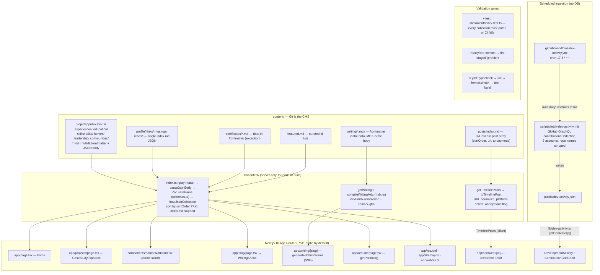

# Portfolio V2 — Reconnaissance Report

**Date:** 17 October 2026
**Status:** Read-only reconnaissance. No code, content, configuration, or dependencies were modified.
**Purpose:** Establish how the current Next.js portfolio and its Markdown/JSON-backed CMS work, before proposing anything for **Portfolio V2** — the expanded, evidence-backed dashboard consolidating AI research, engineering contributions, publications, and notable independent projects, aimed at research admissions committees, fellowship reviewers, and academic evaluators.

All findings below were verified by direct inspection of the working tree. Inferences are labeled as such.

---

## 1. Architecture summary

**Stack (verified from [`package.json`](../package.json))**

| Concern | Choice |
|---|---|
| Framework | Next.js `^16.1.6`, **App Router only** (no `pages/` exists) |
| UI | React `^19.2.0`, Radix primitives (dialog, slot), lucide-react, framer-motion `^13.4.4` |
| Language | TypeScript `5.6.3` (pinned), strict mode ([`tsconfig.json`](../tsconfig.json)) |
| Styling | Tailwind CSS v4 via `@tailwindcss/postcss` ([`postcss.config.mjs`](../postcss.config.mjs)), typography plugin; no `tailwind.config` file |
| Content parsing | gray-matter `^4.0.3`, next-mdx-remote `^6.0.0` (RSC), remark-gfm |
| Validation | Zod `^3.24.2` (content schemas **and** env) |
| Testing | Vitest `^3.2.4` (node env, `lib/**/*.test.ts` only — [`vitest.config.ts`](../vitest.config.ts)) |
| Package manager | npm (`package-lock.json`; no `packageManager` field), Node 22 ([`.nvmrc`](../.nvmrc)) |
| Misc | react-tweet `^3.3.1` (same-origin syndication proxy), lenis (smooth scroll), cobe (globe), `server-only` guards on all content modules |

**Routing and rendering.** 13 static pages + 1 dynamic segment + 2 route handlers: `/` (home), `/about`, `/blog`, `/certificates`, `/community` (placeholder), `/contact` (→ 308 `/about`), `/links`, `/musings`, `/projects`, `/reads`, `/resume`, `/start-here`, `/writing`, `/writing/[slug]`, `/api/tweet/[id]` (`revalidate = 3600`), `/rss.xml`. Pages are server components by default with a few `'use client'` islands ([`WorkGrid.tsx`](../components/home/WorkGrid.tsx), [`case-study-flip-stack.tsx`](../components/ui/case-study-flip-stack.tsx), TimelinePosts, DevelopmentActivity). `/writing/[slug]` is fully SSG via `generateStaticParams` with a numeric-id → slug 308 redirect. No server actions, no `force-dynamic`/`force-static` exports anywhere. No MDX plugin in [`next.config.ts`](../next.config.ts) — MDX compiles at runtime through `next-mdx-remote/rsc`; config only holds security headers and the `/beats → /community` redirect.

**CMS.** Git is the CMS. ~17 collections under `content/` follow one convention: **YAML frontmatter (`type`, `slug`, `sortOrder`, `lastUpdated`) followed by a pretty-printed JSON body**. The pipeline in [`lib/content/index.ts`](../lib/content/index.ts) is: `fs.readFileSync` → gray-matter split → `JSON.parse` body → `schema.safeParse` (throws, failing build/test with file-specific errors) → sort by `sortOrder ?? id`. Two exceptions: `writing/*.mdx` (frontmatter is the data, body is MDX) and `certificates/*.md` (data lives in frontmatter, not the body). A third data path exists outside the CMS: `public/dev-activity.json`, written by [`scripts/fetch-dev-activity.mjs`](../scripts/fetch-dev-activity.mjs) (GitHub GraphQL `contributionsCollection` across up to 3 accounts, repo names deliberately stripped) and refreshed daily by a cron workflow that commits the file.

**Projects page.** [`app/projects/page.tsx`](../app/projects/page.tsx) calls `getProjects()` and maps records into a presentational scroll-flip stack. There is **no filtering, search, sorting UI, categorization, or project detail route** — details are external links (`url`, `githubRepo`) only. The home-page grid filters by `showOnLanding !== 'no'`. Project visuals are static SVGs at `public/projects/{id}.svg`.

**Ops.** CI ([`ci.yml`](../.github/workflows/ci.yml)) runs `typecheck → lint --max-warnings 0 → format:check → test → build` on pushes to `main` and PRs. Pre-commit runs lint-staged (Prettier only). [`lib/env.ts`](../lib/env.ts) Zod-validates `NODE_ENV` and `SITE_URL` (names only; no values reproduced here). [`README.md`](../README.md) specifies Vercel Hobby hosting; no `vercel.json` exists in-repo (deployment state not verifiable from the tree).

---

## 2. Content / data-flow diagram



---

## 3. Relevant files and responsibilities

| File | Responsibility |
|---|---|
| [`lib/content/schemas.ts`](../lib/content/schemas.ts) | Single source of truth for content contracts: every Zod schema + inferred TS types (e.g. `projectSchema`, `publicationSchema`, `timelinePostsSchema` with `superRefine` duplicate-`sortOrder` check) |
| [`lib/content/index.ts`](../lib/content/index.ts) | Server-only loaders: `parseJsonBody`, `loadJsonCollection`, `getProjects`, `getPublications`, `getWriting*`, `getTimelinePosts`, `getPortfolio` aggregate |
| [`lib/content/mdx.ts`](../lib/content/mdx.ts) | `compileWritingMdx` — RSC MDX compilation with `mdxComponents` map |
| [`lib/content/index.test.ts`](../lib/content/index.test.ts) | Content contract tests — all collections must parse; runs in CI via `npm test` |
| [`content/projects/`](../content/projects) | 7 canonical project records + `index.md` (duplicated array — loaders skip it) |
| [`content/publications/`](../content/publications), [`content/honors/`](../content/honors) | Publication records (DOI, venue, ORCID fields) and honors with `image` evidence |
| [`app/projects/page.tsx`](../app/projects/page.tsx) | `/projects` — maps `Project[]` → `CaseStudyFlipItem[]` (no detail route) |
| [`components/ui/case-study-flip-stack.tsx`](../components/ui/case-study-flip-stack.tsx) | Presentational scroll-driven flip stack (client) |
| [`components/home/WorkGrid.tsx`](../components/home/WorkGrid.tsx) | Home cards; only "filter" in the codebase: `showOnLanding !== 'no'` + first-4 fold |
| [`app/writing/[slug]/page.tsx`](../app/writing/[slug]/page.tsx) | The repo's only SSG detail-page pattern (`generateStaticParams`) |
| [`app/resume/page.tsx`](../app/resume/page.tsx) | Full resume view from `getPortfolio()` — the closest existing "evaluator-facing" page |
| [`lib/dev-activity.ts`](../lib/dev-activity.ts) | Types + `getDevActivity()` reading `public/dev-activity.json` |
| [`scripts/fetch-dev-activity.mjs`](../scripts/fetch-dev-activity.mjs) | GitHub GraphQL ingestion; anonymization (repo names never emitted); manual metric corrections |
| [`.github/workflows/dev-activity.yml`](../.github/workflows/dev-activity.yml) | Daily cron refresh + bot commit of the dataset |
| [`.github/workflows/ci.yml`](../.github/workflows/ci.yml) | CI quality gate |
| [`lib/env.ts`](../lib/env.ts) | Zod env validation (`NODE_ENV`, `SITE_URL`) |
| [`docs/deferred-tasks.md`](./deferred-tasks.md) | Sanctioned roadmap — notably "GitHub/ORCID build-time snapshots", Keystatic, drafts, related content, JSON-LD, R2 object storage |
| [`content/featured.md`](../content/featured.md) | Curated featured-id lists — **loaded and tested but rendered by no page** (verified: only referenced in tests) |
| [`public/projects/`](../public/projects) | Per-project illustration SVGs keyed by project `id` |

---

## 4. Current project content schema

Defined by `projectSchema` in [`lib/content/schemas.ts`](../lib/content/schemas.ts):

| Field | Zod shape | Notes |
|---|---|---|
| `id` | `z.number()` | Numeric key; drives `/projects/{id}.svg` asset lookup |
| `title` | `z.string()` | |
| `url` | `string \| null` (optional) | Live/project URL |
| `tools` | `z.array(z.string())` | Free-form strings — **not** linked to the `content/skills` taxonomy |
| `dateLabel` | `z.string()` | Display-only date range |
| `highlights` | `z.array(z.string())` | 2–3 bullets; UI uses `[0]` as tagline, `[1]` as "role" |
| `problem` | `string \| null` (optional) | Landing-card one-liner |
| `sortOrder` | `z.number().optional()` | Display order; falls back to `id` |
| `isResearch` | `string \| null` (optional) | Compared `=== 'yes'` on `/projects`; **not enum-constrained** — any string passes |
| `showOnLanding` | `'yes' \| 'no'` (optional) | Home-grid visibility filter |
| `githubRepo` | `string \| null` (optional) | Repo link |

Important nuance (verified): for JSON-body collections the **frontmatter is ignored by loaders** — only `certificates` and `writing` read frontmatter data. So `slug`/`lastUpdated` in project frontmatter are decorative metadata today.

**Representative record — [`content/projects/revent-ai-lab-platform.md`](../content/projects/revent-ai-lab-platform.md) (verbatim):**

```yaml
---
type: "project"
slug: "revent-ai-lab-platform"
sortOrder: 1
lastUpdated: "2026-10-07T00:00:00.000Z"
---
```

```json
{
  "id": 6,
  "title": "Revent AI Lab",
  "url": "https://ailab.revent.store",
  "tools": ["Next.js", "TypeScript", "PostgreSQL", "Drizzle ORM", "Redis", "BullMQ", "Better Auth", "Stripe"],
  "dateLabel": "Apr 2026 - Present",
  "highlights": [
    "AI agents as a subscription product: multi-tenant, billable, alive in production.",
    "AI Engineer on the platform: company onboarding, per-agent subscription plans, billing through Stripe.",
    "Multi-tenant B2B SaaS on Next.js 16 and Postgres with Drizzle, Redis and BullMQ background jobs, envelope-encrypted secrets, Better Auth for email/password and Google OAuth, and Stripe subscription items per agent."
  ],
  "problem": "Companies want agents they can subscribe to, not one-off builds that never survive the jump to production.",
  "sortOrder": 1,
  "isResearch": "no",
  "githubRepo": null
}
```

Related evidence-bearing schemas already in place: `publicationSchema` (`doi`, `url`, `venue`, `orcidId`, `links[{label,url}]`, `image`), `certificateSchema` (`credentialId`, `verificationUrl`, `fileUrl`), `honorSchema` (`image`), and the dev-activity dataset (aggregate commits/issues/PRs/reviews with `generatedAt` provenance).

---

## 5. Recommended extension points and architectural constraints

**Smallest sufficient extension set** (no database needed — the "Git + Zod + build-time snapshot" pattern already covers projects, contributions, artifacts, metrics, and provenance):

1. **[`lib/content/schemas.ts`](../lib/content/schemas.ts)** — extend `projectSchema` with structured fields (e.g. `metrics[]`, `evidence[]`, `tags[]`, `status`, real dates) or add sibling schemas (`contributionSchema`, `artifactSchema`). This is the canonical-dataset keystone.
2. **[`lib/content/index.ts`](../lib/content/index.ts)** — new getters via the existing `loadJsonCollection`; optionally cross-reference helpers (project ↔ publication ↔ honor ↔ skill).
3. **`content/`** — enrich/add records; no new infrastructure required.
4. **`app/projects/page.tsx` (+ optional `app/projects/[slug]/`)** — the SSG detail-page pattern is proven in `writing/[slug]`; reuse it rather than inventing a rendering mode.
5. **Metrics ingestion** — either extend `scripts/fetch-dev-activity.mjs` or add a second snapshot script following its exact pattern; [`docs/deferred-tasks.md`](./deferred-tasks.md) explicitly sanctions build-time GitHub/ORCID snapshots committed as JSON.
6. **[`lib/content/index.test.ts`](../lib/content/index.test.ts)** — lock every new contract so CI stays the content gate.
7. Latent hook: `getFeatured()`/`content/featured.md` already exist, are schema-validated, and are unrendered — a ready-made curation layer for an evaluator-facing highlight reel.

**Constraints and risks:**

- **Duplication:** every collection's `index.md` duplicates the records (e.g. `content/projects/index.md` restates all 7). Loaders skip `index.md`, so it can silently drift — V2 must declare it documentation-only or generate it.
- **Un-machine-readable evidence:** today's strongest evidence (MMVTG's "R1@0.5 of 60.5, mAP 61.55, published in IEEE") lives inside `highlights` prose strings. Committee-grade provenance needs typed fields with source URLs and as-of dates.
- **Loose typing:** `isResearch` accepts any string; `tools` are uncontrolled strings decoupled from `content/skills`. Both will bite any filtering/categorization V2 adds.
- **Privacy invariants:** the repo-name-stripping rule in `fetch-dev-activity.mjs` and the `anonymous` masking convention in posts must be preserved by any metrics extension (private/employer-repo leakage is an explicit design constraint in the code comments).
- **Maintainability:** validation is duplicated across test + build (both invoke the same loaders), which is a feature — but per-collection error naming is the only debugging aid; keep new schemas error-message-friendly.
- **Performance:** everything is fs-read at build/static-render time; the dataset sizes involved are trivial. The real ceiling is asset weight (large evidence images), for which the deferred R2/object-storage item already reserves a path.
- **Migration risk:** `projectSchema` changes are additive-safe (optional fields), but changing `id` semantics would break `public/projects/{id}.svg` lookups and `featured.md` id lists.

---

## 6. Uncertainties requiring your input

1. **`isResearch` data state:** all 7 project records currently say `"no"` — including MMVTG, which carries an IEEE publication. Intentional, or stale data V2 should correct?
2. **"Contributions" scope:** does the V2 dashboard mean the existing aggregate GitHub activity (extend `dev-activity.json`), or per-contribution records (individual PRs/issues/commits with links)? Different schemas and ingestion.
3. **Project detail pages:** should V2 add `/projects/[slug]` (the `writing/[slug]` pattern), keep external links only, or use MDX case studies?
4. **Provenance granularity:** do committee-facing metrics need `source` URL + `asOf` date per claim (assumption: yes, given the audience — unverified)?
5. **ORCID / Google Scholar:** `orcidId`/`orcidUrl` fields exist but the ORCID snapshot is parked in deferred-tasks. Wire it for V2?
6. **Evidence artifacts:** stored as files in `public/` (current convention: `public/achievements`, `public/publications`, `public/projects`) vs. links-only vs. R2? Deferred-tasks reserves R2 for heavy media.
7. **IA:** new route(s) (e.g. `/research`) vs. expanding `/projects` and `/resume`? `featured.md` — wire it up or delete it?
8. **Deployment state:** CI files exist in-repo, but production Vercel status/custom domain (which `SITE_URL` depends on) is not verifiable from the tree.

---

## 7. Proposed next step (inspection-based)

Before any schema is written: a **claim-to-evidence inventory**. Go record-by-record across the 7 projects, 5 publications, and 6 honors, and for each factual claim list (a) the claim, (b) the evidence that exists today in the repo (URL, DOI, repo link, image, certificate, metric), and (c) the evidence that is missing. This maps directly onto which fields the V2 `projectSchema` extension must add (metrics, evidence links, provenance) versus which are already covered, and it surfaces stale data (like `isResearch`) without touching code. Run `npm test` alongside it to confirm the current content baseline is green, then review the inventory + a draft schema diff before any implementation.
